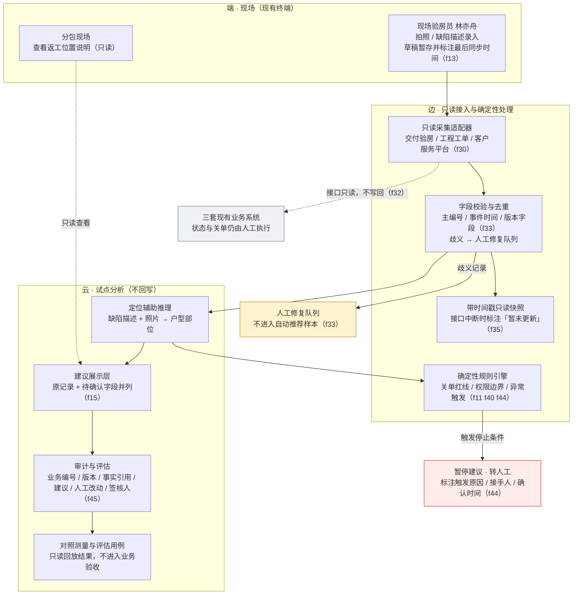
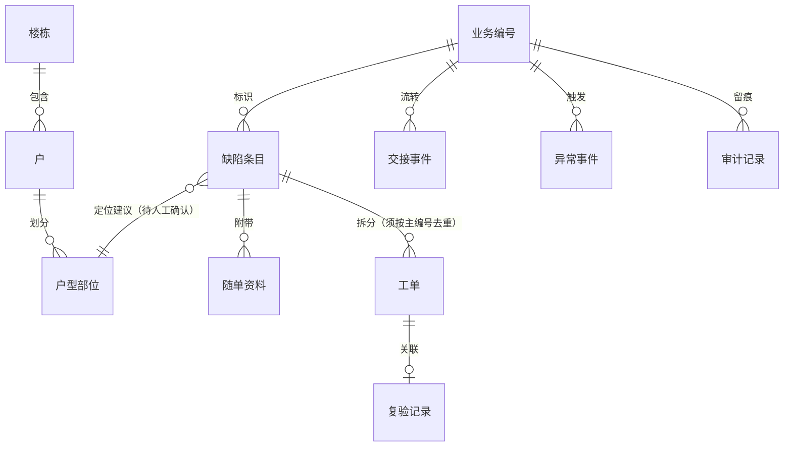

# 城居发展 · 交房缺陷与整改协同 —— 技术方案

> **文档性质**：FDE 训练「方案设计」阶段交付物（试点方案与构建计划）。
> **数据基础**：合成训练场景下的六角色访谈（36 条事实，编号 f00–f55），**全部结论均为待验证假设**。
> **试点边界**：首期仅做历史资料回放与小范围并行，只读汇总优先，**不替换现有业务、不回写工单、不自动关单**。
> **前序依据**：客户简报、现状信息请求表、业务发现访谈问题库、利益相关者资料与分工、现场调研报告、业务需求发现报告、现状流程图。

---

## 一、需求基线与约束（方案设计的输入）

### 1.1 业务目标与验收硬指标

| 项目 | 内容 | 来源 |
| --- | --- | --- |
| 业务目标 | 重复缺陷占比 18% → 7%；平均整改周期 14 天 → 8 天 | f00 |
| 首期预算 | 17 万元（含集成、培训、验证），收益须扣维护与人工复核成本 | f03 |
| 试点范围 | 单楼栋，历史资料回放 + 小范围并行，不替换现有业务 | f05 |
| 验收硬指标 | 缺陷**定位**准确率 98%（非归类正确率）、未复验关单为零 | f02 / f42 |
| 工作量基线 | 600 户/批、约 9 条缺陷/户、分派核对约 15 分钟 | f12 / f51 |

### 1.2 待验证的问题聚焦

1. **照片—户型部位—返工位置定位辅助**：一线痛点为缺陷描述与照片对应不上户型部位、分包看不懂返工位置（f10），关键说明常留在便签或群消息、未随单据交接（f14）。该环节同时关联重复缺陷占比与分派核对耗时，价值最直接。
2. **未复验关单强制人工兜底**：业主不在现场、整改完成却无复验授权、系统直接关单（f11）属明确红线，直接对应「未复验关单为零」与客户签字边界。

### 1.3 不可越过的权限与口径红线

- 整改项目专员只能整理、校核、发起复核，**不能代替专业签核**（f22）；规则冲突须附两版本给质量经理，不自行合并或选宽松条款（f24）。
- 质量责任与赔偿由授权人员确认，**业主意见不能被自动覆盖**（f40）；敏感资料仅授权岗位可见，不得借用他人账号（f41）。
- 缺陷归类与整改追踪**不代替工程质量鉴定或客户签字**（f05 / f52）。
- 现有接口可读缺陷与状态，**不自动确认交付、不自动关闭争议工单**（f32）；三套系统账号独立、无统一状态视图（f30）。
- 「完成」定义冲突：施工认为整改结束即完成，客户要求现场复验通过（f50）；指标须固定分母、排除规则与统计周期，不得拆单提高比例（f53）。
- 复验通过率因一条缺陷拆多张工单而重复计数（f31），须校验主编号、事件时间、版本字段（f33）。

### 1.4 试点前必须补齐的口径（阻断项）

| # | 待补事项 | 责任人 / 来源 |
| --- | --- | --- |
| 1 | 98% 定位准确率的判定人、样本量、按户或按缺陷条数统计 | 顾明岚 + 傅景（f02 / f42） |
| 2 | 各节点等待 / 处理时间分开量化，形成归因基线 | 顾明岚（f01） |
| 3 | 完成定义书面口径 | 唐映秋 + 叶书对齐，业务负责人拍板（f50） |
| 4 | 主编号、事件时间、版本字段的跨系统映射 | 秦芮（f33） |
| 5 | 审批节点清单与权限矩阵 | 唐映秋 / 傅景（f22 / f24 / f41） |
| 6 | 系统能否按角色阻断关单、接口是否支持回写审批 | 秦芮（f30 / f32） |
| 7 | 反馈入口与回音时限 | 叶书（f54 / f55） |
| 8 | 90 天评价记录留存与删除执行人、复核链 | 傅景（f43） |

> 上述 1–8 项任一未闭环，均不进入并行试点，仅保持只读回放。

---

## 二、最小试点与排除范围

| 维度 | 范围内（本期做） | 排除 / 不在本期（明确不做） |
| --- | --- | --- |
| 数据 | 单楼栋历史资料回放、已授权状态的只读汇总 | 真实业主个人信息、跨楼栋推广 |
| 功能 | 缺陷描述与照片 → 户型部位的定位建议；待确认字段提示 | 自动缺陷归类定责、自动关单、自动赔偿结论 |
| 流程 | 异常触发时暂停建议、转人工核对并留痕 | 替换现有交接流程、代替客户签字与质量鉴定 |
| 系统 | 只读接入三套系统、带时间戳快照 | 回写工单、修改业务状态、账号权限打通 |
| 输出 | 建议结果 + 原记录并列展示 + 审计轨迹 | 覆盖原记录、生成对外承诺 |

---

## 三、业务价值及对照测量

| 指标 | 基线 | 目标 | 测量口径（须先确认） |
| --- | --- | --- | --- |
| 缺陷定位准确率 | 未测 | 98% | 判定人、样本量、按户 / 按条（f02 / f42） |
| 分派核对耗时 | 约 15 分钟/批 | 下降 | 等待时间与处理时间分开计时（f01 / f12） |
| 重复缺陷占比 | 18% | 7% | 固定分母与排除规则（f00 / f53） |
| 平均整改周期 | 14 天 | 8 天 | 按节点归因，不得拆单（f00 / f31） |
| 未复验关单数 | 存在（f11） | 0 | 以复验授权记录为准，人工兜底留痕 |

**对照方式**：同一楼栋采用「现有人工流程」与「并行只读建议」双轨记录；建议不进入业务执行链，仅由具名人员复核并登记采纳 / 不采纳及原因。统计周期、分母与排除规则由顾明岚与傅景共同书面确认后锁定。

---

## 四、端—边—云架构（方案设计主图）

**分层职责说明**

| 层 | 职责 | 确定性 / 模型分工 | 人工控制 |
| --- | --- | --- | --- |
| 端 | 现场录入、草稿暂存、只读查看返工位置 | 全部确定性；沿用现有终端，不新增现场设备 | 验房员本人复核 |
| 边 | 只读采集、字段校验与去重、快照、红线规则 | **确定性规则为主**：主编号校验、状态只读、关单阻断判定 | 歧义进人工修复队列 |
| 云 | 定位建议、对照测量、审计留痕 | **模型仅做候选建议**，输出原记录与待确认字段 | 采纳与否由具名人员决定并签核 |

**关键设计约束**：端到云的数据流为单向只读；任何关单、赔偿、客户签字、状态变更均不经过本方案链路，仍由现有人工流程与授权岗位执行。

---

## 五、Ontology（业务对象与关系）

| 对象 | 关键字段 | 来源 | 口径说明 |
| --- | --- | --- | --- |
| 业务编号 | 主编号、事件时间、资料版本 | 三套系统映射（f33 待核实） | **唯一主键**，跨系统去重与补齐依据（f35） |
| 楼栋 / 户 | 楼栋号、户号、户型图版本 | 交付验房系统 | 试点限定单楼栋（f05） |
| 户型部位 | 部位编码、部位名称、户型图坐标 | 户型图资料 | 「照片—部位—返工位置」映射的目标 |
| 缺陷条目 | 缺陷编号、描述、照片、状态 | 交付验房系统 | 一条缺陷可对应多张工单，须按主编号合并（f31） |
| 随单资料 | 户型图、缺陷照片、分包范围、整改时限、复验记录 | 唐映秋（f21） | 交接五要素的输入来源 |
| 工单 | 工单号、处理人、处理状态、版本 | 工程工单系统 | 只读；不得写回（f32） |
| 复验记录 | 复验授权、复验结果、复验时间 | 交付验房 / 客户服务平台 | 「未复验关单为零」的判定依据（f11 / f42） |
| 交接事件 | 业务编号、当前版本、处理状态、未解决事项、接手人、确认时间 | 唐映秋（f23） | 对方确认接手才算完成 |
| 异常事件 | 触发原因、接手人、确认时间、处理结论 | 傅景 / 林亦舟（f44 / f15） | 四类触发转人工，错误结果不覆盖原记录 |
| 审计记录 | 业务编号、资料版本、事实引用、建议结果、人工改动、签核人 | 傅景（f45） | 不记录口令与不必要个人信息 |

---

## 六、BOM / SDK 与技术契约

### 6.1 组件清单（BOM）

| 组件 | 形态 / 选型 | 职责 | 状态 |
| --- | --- | --- | --- |
| 现场录入 | 沿用现有验房终端 | 拍照、描述录入、草稿暂存与同步时间标注（f13） | 已有 |
| 只读采集适配器 | 三套系统只读接口封装 | 读取缺陷与状态，不写回（f32） | 待确认接口范围 |
| 字段校验与去重模块 | 确定性规则 | 主编号 / 事件时间 / 版本校验，歧义入人工修复队列（f33） | 待建 |
| 只读快照服务 | 带时间戳缓存 | 接口中断标注「暂未更新」，重连按业务编号去重补齐（f35） | 待建 |
| 状态刷新调度 | 定时同步 | 每小时更新已授权状态，超一周期标待刷新（f34） | 待建 |
| 定位辅助模块 | 模型推理（候选建议） | 缺陷描述 + 照片 → 户型部位候选，输出置信与待确认字段 | 待验证口径后启用 |
| 规则引擎 | 确定性规则 | 关单红线、权限边界、异常四类触发（f11 / f40 / f44） | 待建 |
| 建议展示层 | 只读界面 | 原记录与建议并列，错误结果不覆盖原记录（f15） | 待建 |
| 审计日志 | 结构化留痕 | 六要素留痕，不记录口令与不必要个人信息（f45） | 待建 |
| 评估用例集 | 回放样本 + 对照记录 | 支撑模拟验证、真实模型验证、业务验收三层区分 | 待补 |

> 说明：本期不引入账号打通、不修改三套系统权限模型、不新增现场硬件。模型相关组件在 98% 判定口径与样本方案（f02 / f42）书面确认前，仅以离线回放方式验证。

### 6.2 接口契约

| 契约项 | 约定 |
| --- | --- |
| 读写权限 | **只读**；接口不自动确认交付、不关闭争议工单（f32） |
| 读取字段 | 缺陷编号、描述、照片引用、工单状态、复验结果、业务编号、事件时间、资料版本（最终清单待 f33 核实） |
| 更新频率 | 每小时同步已授权状态，超一个周期标记「待刷新」（f34） |
| 中断降级 | 使用带时间戳只读快照并显示「暂未更新」，重连后按业务编号去重补齐；现有人工流程继续运行（f35） |
| 歧义处理 | 有歧义的记录进入人工修复队列，**不进入自动推荐样本**（f33） |
| 写回 | 本期无。若后续决定回写工单，须先确定审批路径与以哪个系统为准（f30 / f32） |

### 6.3 关键 SDK / 集成点

- 三套系统只读数据接入（接口范围与字段清单待秦芮核实）。
- 户型图与部位坐标资料接入（版本与权限待唐映秋、傅景确认）。
- 审计与评估数据导出（供离线回放与对照测量，不回流业务系统）。
- 身份与权限沿用现有岗位授权，本方案不新增账号、不借用账号（f41）。

---

## 七、代理职责与人工控制

| 环节 | 代理 / 模块可做 | 只能由人完成 | 责任人 |
| --- | --- | --- | --- |
| 缺陷登记 | 提示照片与部位是否匹配、标记待确认字段 | 现场事实确认、异常时暂停建议 | 林亦舟（f15） |
| 定位建议 | 给出户型部位候选及依据 | 采纳与否、专业签核 | 林亦舟 / 傅景（f22） |
| 规则冲突 | 并列呈现两个版本，不合并 | 裁决并签核 | 傅景（f24） |
| 交接分派 | 提示交接五要素是否齐全 | 对方确认接手、超时升级 | 唐映秋（f23 / f25） |
| 关单 | 检测未复验关单并阻断提示 | 复验授权、质量责任与赔偿确认 | 傅景 / 叶书（f40 / f50） |
| 客户反馈 | 关联原业务编号与资料版本 | 受理争议、对外承诺 | 叶书（f54） |
| 审计 | 记录六要素 | 签核与批准 | 傅景（f45） |

**异常四类触发（统一转人工）**：未复验关单、资料缺依据、两版本冲突、关键系统不可用（f44）。转人工时必须标注触发原因、接手人、确认时间；建议须显示对应原记录与待确认字段，错误结果不覆盖原记录（f15）。

---

## 八、构建计划与责任人

| 阶段 | 任务 | 输入 | 输出 | 责任人 | 前置条件 |
| --- | --- | --- | --- | --- | --- |
| 0 · 口径确认 | 锁定 98% 判定口径、节点耗时基线、完成定义、主编号映射、权限矩阵 | 1.4 节清单 | 验收标准草案 | 顾明岚 + 傅景 + 秦芮 | 各角色共同确认 |
| 1 · 只读接入 | 三套系统只读适配、字段校验、去重、快照 | 接口字段清单 | 只读数据视图 | 秦芮 | 阶段 0 完成 |
| 2 · 规则与展示 | 红线规则引擎、建议展示层、审计留痕 | 交接与异常规则 | 只读建议原型 | 秦芮 + 唐映秋 | 阶段 1 完成 |
| 3 · 离线回放 | 单楼栋历史资料回放、评估用例与对照记录 | 历史资料 | 回放结果与分析 | 唐映秋 + 林亦舟 | 阶段 0–2 完成 |
| 4 · 小范围并行 | 双轨记录、人工复核登记、误判周收集 | 回放通过的原型 | 试点结论 | 顾明岚 + 叶书 | 回放通过终止条件检查 |
| 5 · 决策 | 复测 98% 与未复验关单为零，决定是否继续 | 试点结论 | 继续 / 暂停决定 | 顾明岚（傅景可否决上线） | 阶段 4 完成 |

---

## 九、成功、继续与终止标准

| 关卡 | 标准 | 判定 / 签核 | 未达标动作 |
| --- | --- | --- | --- |
| G0 口径关 | 1.4 节八项书面闭环 | 顾明岚 + 傅景 | 不进入只读回放后的并行阶段 |
| G1 数据关 | 主编号去重有效、复验通过率不重复计数 | 秦芮 | 退回人工修复队列 |
| G2 定位关 | 缺陷定位准确率 98%（按已锁定口径） | 顾明岚 + 傅景共同确认 | 暂停复盘，不进入试点 |
| G3 红线关 | 未复验关单为零，业主意见未被自动覆盖 | 傅景 | 触发停止条件，暂停试点并复盘 |
| G4 权限关 | 专业签核、赔偿确认、客户签字均由授权人完成 | 傅景 + 叶书 | 判定越权，暂停建议链路 |

**继续条件**：G0–G4 全部通过，且客户侧完成定义已统一。**终止条件**：任一红线被触发（无复验授权关单、资料缺依据、两版本冲突、关键系统不可用），或 98% 口径未达成一致，即暂停试点并由负责人复盘（f42 / f44）。试点为只读汇总还是回写工单的决策未定前（f32），一律保持只读。

---

## 十、风险、留存与合规

| 风险 | 影响 | 控制措施 |
| --- | --- | --- |
| 定位准确率口径不清 | 验收无法归因 | G0 书面锁定判定人与样本方案 |
| 一缺陷多工单重复计数 | 指标虚高 | 主编号去重、固定分母（f31 / f33 / f53） |
| 系统无法按角色阻断关单 | 红线靠提示无法保证 | 只读试点 + 人工兜底，阻断能力先验证（f30 / f32） |
| 敏感资料越权可见 | 合规风险 | 仅授权岗位可见，不借用账号（f41） |
| 建议覆盖原记录 | 追溯失效 | 原记录与建议并列，错误结果不覆盖（f15） |
| 留存期限未定 | 审计与删除责任不清 | 评价记录暂留 90 天，期满复核删除或归档（f43） |

**审计留痕六要素**：业务编号、资料版本、事实引用、建议结果、人工改动、签核人；不记录口令与不必要个人信息（f45）。合成训练不代表真实授权、业务执行或客户验收，任何关单、赔偿、客户签字均须人工确认。

---

## 附：事实编号索引说明

本方案引用的 f00–f55 为六角色访谈事实编号，原始记录见《业务需求发现报告》与《现场调研报告》；流程图与异常路径见《现状流程图》。每条结论均标注来源，尚未核实的事项一律以「待验证假设」表述，不作为已确认需求。
